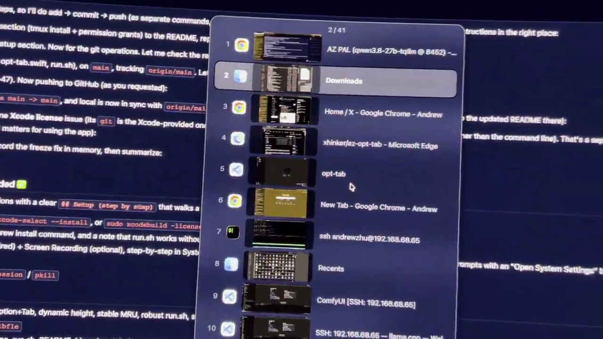

# az-opt-tab

A Windows-11-style **per-window** switcher for macOS. Hold **Option** and press **Tab** to
cycle through individual *windows* (most-recently-used first), hold to auto-cycle, and release
**Option** to bring the selected window to the front.

Unlike the built-in `Cmd+Tab` (which switches *apps*), az-opt-tab switches **windows** —
Chrome tab A → VS Code window B → iTerm pane C. It covers **all Spaces**, so windows on other
desktops are included, and it shows a **live thumbnail** of every window.



## What's new

- **v18 (2026-10-20) — single-window activation.** Committing to a window now brings
  **only that window** to the front. Previously `NSRunningApplication.activate()` fronted
  the whole app, so *every* window of that app (e.g. all your Chrome windows) popped up
  above the app you were on. It now uses the WindowServer call
  `_SLPSSetFrontProcessWithOptions` with the specific window id, which raises just that
  window. (This also adds a second private symbol — see the build note below.)

## Features

- **Per-window** switching (not per-app), most-recently-used order like Windows Alt+Tab
- **All Spaces** — windows on other desktops are listed and switchable (macOS follows to its Space)
- **Hold to auto-cycle** — hold `Option+Tab` to advance down, `Option+Shift+Tab` to advance up (throttled to a comfortable ~10/sec)
- **Live window thumbnails** (ScreenCaptureKit), with a RAM cache so reopens are instant
- **Multi-monitor** — one overlay per screen, all in sync
- **Mouse** — scroll to navigate, click a row to jump straight to that window
- **Fast** — 0ms to open, ~15–38ms to commit (window on screen)

## Setup (step by step)

### 1. Prerequisites
- **macOS** (built and tested on macOS 26 / Darwin 25). Uses public APIs plus two
  long-stable private symbols — `_AXUIElementGetWindow` and
  `_SLPSSetFrontProcessWithOptions` (the same ones yabai / alt-tab-macos use). `run.sh`
  links the private `SkyLight.framework` automatically, so a plain `./run.sh` is all you need.
- **Xcode Command Line Tools** (to build the Swift source). If `swiftc` isn't on your machine:
  ```bash
  xcode-select --install          # installs the CLT (includes swiftc)
  ```
  If you have full Xcode and `swiftc` complains about the license:
  ```bash
  sudo xcodebuild -license accept
  ```

### 2. Install tmux (recommended)
`run.sh` launches the app in a persistent tmux session so you can watch its log and stop it
cleanly. If you don't have tmux, install it via Homebrew:
```bash
# install Homebrew first (skip if you already have it)
/bin/bash -c "$(curl -fsSL https://raw.githubusercontent.com/Homebrew/install/HEAD/install.sh)"
brew install tmux
```
> `run.sh` still works without tmux (it falls back to a background process + `opt-tab.log`),
> but tmux makes watching the log and stopping the app much easier.

### 3. Grant permissions (one-time)
The app needs two macOS permissions, set in **System Settings → Privacy & Security**:

**Accessibility** — *required* (window activation + keyboard monitoring):
1. System Settings → **Privacy & Security** → **Accessibility**
2. Click **＋**, then add the binary: `~/az_git_folder/az-opt-tab/opt-tab`
   (or the terminal app you launch from — a terminal-launched app inherits the terminal's grant)
3. Make sure its toggle is **on**

**Screen Recording** — *optional* (live thumbnails; without it, rows show app icons):
1. System Settings → **Privacy & Security** → **Screen Recording**
2. Click **＋**, add the same binary, toggle **on**

> Easiest path: run `./run.sh` once — the app prompts for Accessibility on startup with an
> "Open System Settings" button that jumps straight to the right panel.

### 4. Run
```bash
./run.sh
```
`run.sh` builds the binary if it's missing, then starts the app in a tmux session named `opt-tab`.

### 5. Manage
```bash
tmux attach -t opt-tab        # watch the live log   (detach: Ctrl+B then D)
tmux kill-session -t opt-tab  # stop the app         (or: pkill -f opt-tab)
./run.sh                      # start it again
```

## Usage

| Action | Effect |
|---|---|
| `Option+Tab` (quick tap) | Open the switcher on the most recent *other* window |
| **Hold** `Option+Tab` | Auto-advance to the next window (down) |
| **Hold** `Option+Shift+Tab` | Auto-advance to the previous window (up) |
| Mouse scroll on the overlay | Next (down) / previous (up) |
| Mouse click on a row | Jump straight to that window |
| Release `Option` | Bring the highlighted window to the front |

The overlay shows all windows as a vertical list centered on the selection: **sequence number**
(1 = most recent) + **app icon** + **live thumbnail** + **window title** (falls back to app name),
with `↑`/`↓` arrows when there are more windows and an `n / total` counter.

## How it works

| Concern | Approach |
|---|---|
| Global hotkey + auto-repeat | A `CGEventTap` on the Tab key sees the system's key auto-repeat, so **holding** Tab fires repeated events → auto-advance (throttled to ~10/sec) |
| Window inventory (all Spaces) | Per-app Accessibility `kAXWindowsAttribute` over `NSWorkspace.runningApplications` |
| MRU ordering | AX `kAXFocusedWindowAttribute` polled at 300ms; reorders only on focus change so the list is stable while navigating |
| Window activation | `_SLPSSetFrontProcessWithOptions(psn, wid, userGenerated)` — fronts the process and raises **only** the target window (not all the app's windows) — then `kAXRaiseAction` to make it key+focused |
| wid ↔ AX element bridge | `_AXUIElementGetWindow` (private, stable 15+ years) |
| Option-release (commit) | `NSEvent` `.flagsChanged` monitor + a 300ms tick fallback (`CGEvent(source: nil).flags`) |
| Live thumbnails | One low-res `SCStream` per visible window (1 fps) → frames converted on background queues into a RAM cache; a slow 500ms timer applies them to the UI and **pauses while you're navigating** so Tab stays at top priority |
| No-flicker navigation | Persistent row slots updated in place; only changed rows redraw |
| Multi-monitor | One overlay panel per `NSScreen`, all driven by a shared state machine |

### Performance notes

- **0ms to open** — the window inventory is warmed at launch and refreshed in the background
  (~2s), never rebuilt on the Tab path.
- **~15–38ms to commit** — the residual time is the window server raising the window.
- **Instant reopen** — the last thumbnail per window is kept in RAM across open/close.
- **Decoupled threads** — thumbnail capture/conversion runs on background queues; the UI apply
  timer yields while you're actively Tabbing, so navigation never waits on thumbnails.

## Files

- `opt-tab.swift` — the whole program (~750 lines, single file)
- `run.sh` — launcher: builds the binary if missing, runs in a tmux session (background fallback if tmux is absent)

## Credits

Modeled on [lwouis/alt-tab-macos](https://github.com/lwouis/alt-tab-macos) (the reference
Windows-style switcher for macOS). This project keeps the same semantics but is a compact,
single-file implementation on public APIs.

## License

MIT — see [LICENSE](LICENSE).
